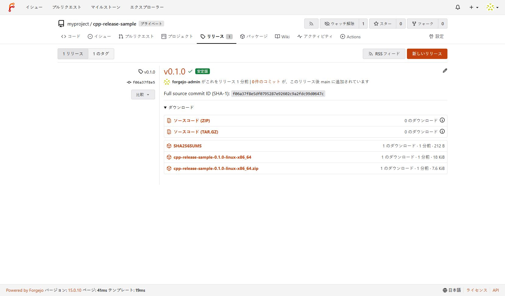
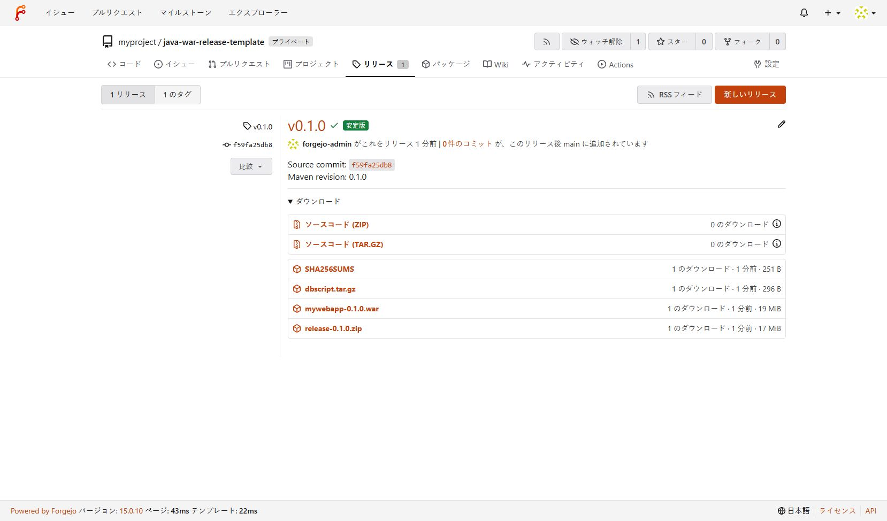

# Forgejo リリース用リポジトリの構築

このリポジトリは、Forgejo の組織 `myproject` に Java と C++ のリリース用リポジトリを作り、Actions でビルド・梱包・リリースするための手順とサンプルをまとめたものです。対象は Oracle Linux 8 上の Forgejo 15.0 / Runner 13.2 の検証環境です。実プロジェクトへ適用するときは、各サンプルの README にあるビルド設定と配布物を実装チームが合わせます。

## 作業の順序

1. **Forgejo の基盤を用意する。** 新しく構築する場合は[VM の準備](vm/README.md)、[配布物の準備](preparation.md)、[Forgejo の導入](installation.md)を参照します。既存の検証 VM を使う場合は導入手順を繰り返さず、サービスの稼働を確認します。
2. **`myproject` と組織 Runner を用意する。** [組織・Runner 登録手順](myproject-runner-registration.md)に従い、組織を作成して Runner を組織単位で登録し、オンライン状態を確認します。リポジトリはその後に作成できます。
3. **組織内にリリース用リポジトリを作る。** [ワークフロー導入手順](forgejo-workflow.md)に従い、新規リポジトリを作成します。既存の GitLab などにソースがある場合は、同手順の移行方法も利用できます。リポジトリを用意した後、Actions と Runner を確認し、ワークフローを配置します。
4. **ビルドとリリースを確認する。** `main` への push でビルド・テスト・梱包を確認し、リリースするときは Actions 画面からタグ名を入力して手動実行します。push だけではリリースを作りません。

## 文書の役割

| 文書 | 読む場面 |
| --- | --- |
| [vm/README.md](vm/README.md) | 検証 VM の OS と接続を新しく準備するとき |
| [preparation.md](preparation.md) | オフライン環境へ持ち込む Forgejo・Runner・RPM を準備するとき |
| [installation.md](installation.md) | Forgejo と検証 VM を新規構築・再現するとき。ここでは `forgejo-admin` 所有リポジトリ向けの Runner も登録する |
| [myproject-runner-registration.md](myproject-runner-registration.md) | 既存の検証 VM に `myproject` 組織向けの Runner 接続を追加するとき |
| [forgejo-workflow.md](forgejo-workflow.md) | 組織配下にリポジトリを新規作成、または既存の GitLab などから移行し、ワークフローと Actions を動かすとき |
| [Java WAR サンプル](examples/java-war-release-template/README.md) | WAR、DDL アーカイブ、ZIP の内容を実プロジェクトへ合わせるとき |
| [C++ サンプル](examples/cpp-release-sample/README.md) | 実行ファイル、起動・停止シェル、共有ライブラリの梱包を合わせるとき |

## 検証記録と構築手順の区別

現行 VM では `forgejo-admin` ユーザー単位の Runner と、同ユーザーが所有するサンプルリポジトリを先に検証しました。これらは `myproject` 組織の Runner やリリース用リポジトリへ自動では切り替わりません。今回の構築では、既存 Runner サービスに**組織向けの登録を追加**してから、組織が所有するリポジトリを用意します。

[myproject のリリース再検証記録](vm/release-workflow-verification-2026-10-25.md)、[VM 導入の検証記録](vm/installation-verification.md)、[Java JAR サンプルの検証記録](vm/java-release-verification.md)、[初期 C++ サンプルの検証記録](vm/cpp-release-verification.md)は、実施時点の結果を残した資料です。現在のリリース手順は上の導入文書と各サンプルの README を参照してください。

## リリースページの再確認（2026-10-25）

検証 VM を「OS準備完了」に復元し、[配布物の準備](preparation.md)、[Forgejo の導入](installation.md)、[組織 Runner の登録](myproject-runner-registration.md)、[ワークフローの導入](forgejo-workflow.md)の順に再確認しました。`myproject` の非公開リポジトリに現在の C++・Java WAR サンプルをそれぞれ配置し、`main` への push と Actions からの `v0.1.0` 手動リリースが両方成功しました。組織・リポジトリ・Runner の登録と Actions の起動には、画面操作に相当する Forgejo API も使用しています。

| リポジトリ | リリースページ | 確認した配布物 |
| --- | --- | --- |
| [C++](http://192.168.131.131:3000/myproject/cpp-release-sample/releases/tag/v0.1.0) | `v0.1.0` | 実行ファイル、ZIP、`SHA256SUMS`。ZIP 内に `start_cpp.sh` と `stop_cpp.sh` |
| [Java WAR](http://192.168.131.131:3000/myproject/java-war-release-template/releases/tag/v0.1.0) | `v0.1.0` | `mywebapp-0.1.0.war`、`dbscript.tar.gz`、ZIP、`SHA256SUMS` |

両リリースは公開状態で、添付ファイルの SHA-256 と ZIP の内容を確認しました。以下は管理者として表示したリリースページです。リンク先は検証 VM のアドレスで、接続できる環境から閲覧できます。

### C++ リリース

### Java WAR リリース

